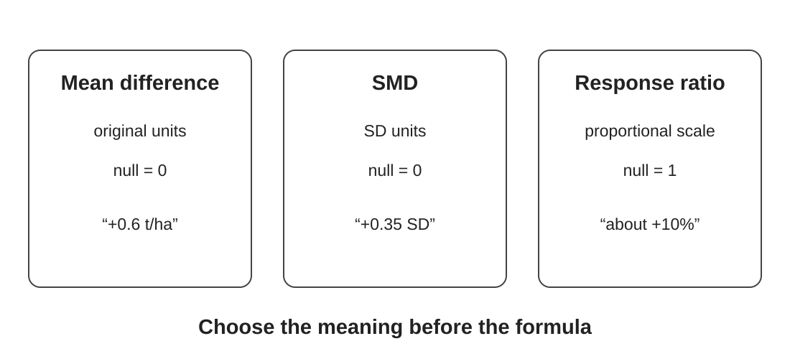

## The job of an effect size

<div class="flow">
<div>Study result</div><div class="arrow">→</div><div>Comparable effect</div><div class="arrow">→</div><div>Sampling variance</div><div class="arrow">→</div><div>Meta-analysis</div>
</div>

<div class="key fragment">The effect measure defines what we are synthesising.</div>

::: {.notes}
Open with the conceptual job rather than a formula. Meta-analysis needs study results expressed on a scale that has a consistent meaning across studies, plus an estimate of their sampling uncertainty. Emphasise that choosing an effect size is part of defining the estimand; it is not merely data preparation.
:::

## Learning objectives

By the end of this module, you should be able to:

::: {.incremental}
- explain why meta-analysis needs an effect size **and** sampling variance;
- distinguish mean difference, standardised mean difference and response ratio;
- select an effect measure that matches the synthesis question;
- calculate log response ratios and sampling variances with `metafor`;
- back-transform log response ratios for interpretation.
:::

::: {.notes}
The goal is not to memorise every formula. Participants should understand what each measure means, what information it preserves or discards, and why the choice is substantive.
:::

## One comparison, several possible effects

| | Reduced tillage | Conventional |
|---|---:|---:|
| Mean SOC | 22.1 | 20.0 |
| SD | 4.2 | 4.0 |
| n | 20 | 20 |

::: {.columns}
::: {.column width="33%"}
**Difference**  
+2.1 units
:::
::: {.column width="33%"}
**Ratio**  
1.105
:::
::: {.column width="33%"}
**Relative difference**  
+10.5%
:::
:::

::: {.notes}
Ask: which is easiest to interpret? Then: which would still make sense if another study used a different unit or had a very different baseline? The same raw data can answer subtly different questions depending on the effect measure.
:::

## Mean difference: keep the original unit

$$MD = \bar X_T - \bar X_C$$

::: {.columns}
::: {.column width="50%"}
**Useful when**

- the outcome is measured on the same scale;
- the unit itself is meaningful;
- an absolute change answers the question.
:::
::: {.column width="50%"}
<div class="card">
<strong>Interpretation</strong>
“Yield was 0.6 t/ha higher.”

**Null = 0**
</div>
:::
:::

::: {.notes}
The original unit is often a major advantage. Do not standardise simply because meta-analysis software makes it easy. If tonnes per hectare is the decision-relevant quantity, preserve it.
:::

## Standardised mean difference: change the question

$$SMD = \frac{\bar X_T-\bar X_C}{SD_{pooled}}$$

<div class="question fragment">
The effect is now expressed in <strong>standard deviation units</strong>. Is that the quantity your users need?
</div>

::: {.incremental}
- Useful for a similar construct measured on genuinely different scales.
- Often reported as Hedges' *g* after small-sample correction.
- Differences in SD can reflect populations and measurement, not just scale.
:::

::: {.notes}
This is an important warning slide. SMD is not a generic solution to different units. Standardisation changes the estimand. Mention Hedges' g, but keep the focus on interpretation rather than formulae.
:::

## Response ratio: proportional change

$$RR=\frac{\bar X_T}{\bar X_C}$$

We usually analyse:

$$\ln(RR)=\ln(\bar X_T)-\ln(\bar X_C)$$

::: {.columns}
::: {.column width="50%"}
**Ratio scale**  
Null = **1**
:::
::: {.column width="50%"}
**Log scale**  
Null = **0**
:::
:::

::: {.notes}
Explain why the log scale is useful: proportional increases and decreases become more symmetric. A doubling and halving are +0.693 and −0.693. The model can live on the log scale while interpretation returns to the ratio scale.
:::

## Back-transform before you communicate

<div class="center big">
$\ln(RR)=0.095$

↓

$RR=e^{0.095}\approx1.10$

↓

**about 10% higher**
</div>

$$\%\Delta = 100\times(RR-1)$$

::: {.notes}
For negative effects, avoid casual symmetry claims on the percentage scale. RR = 0.80 means 20% lower. Encourage participants to back-transform before explaining results to non-technical audiences.
:::

## Choose the measure from the question

<div class="cards">
<div class="card"><strong>Absolute</strong>How many t/ha more yield?<br><br>→ Mean difference</div>
<div class="card"><strong>Standardised</strong>How large is the difference relative to within-study variability?<br><br>→ SMD</div>
<div class="card"><strong>Proportional</strong>What proportional change in SOC occurs?<br><br>→ Response ratio</div>
</div>

<div class="key fragment">Meaning first. Convenience second.</div>

::: {.notes}
Ask participants for examples from their own work. This is illustrative, not a mechanical decision rule. Study design, outcome distribution and data structure also matter.
:::

## Three measures, three meanings

::: {.figure-frame}
{fig-alt="Comparison of mean difference, standardised mean difference and response ratio, showing their units, null values and example interpretations."}
:::

::: {.notes}
Use this as the synthesis slide before the decision exercise. The choice is not about which statistic is most sophisticated; it is about which quantity answers the review question while remaining comparable across studies.
:::

## A 60-second decision exercise

Which effect measure would you start with?

::: {.incremental}
1. Fertiliser increases wheat yield, reported as kg/ha in every study.
2. Animal welfare is measured using several validated continuous scales.
3. Soil carbon is reported in several units, but the question is proportional change relative to control.
:::

<div class="fragment question">What scientific interpretation would each choice imply?</div>

::: {.notes}
Suggested starting answers: MD; possibly SMD if the scales genuinely measure the same construct; response ratio. Stress that the justification matters more than the label.
:::

## Effect size alone is not enough

Two studies can estimate the same effect but with very different precision.

For independent groups, an approximate variance for $\ln(RR)$ is:

$$v_i=\frac{SD_T^2}{n_T\bar X_T^2}+\frac{SD_C^2}{n_C\bar X_C^2}$$

<div class="key fragment">Effect estimate + sampling variance travel together.</div>

::: {.notes}
Do not derive the equation. The conceptual point is that an estimate from a small noisy experiment carries less information than the same estimate from a precise experiment.
:::

## Precision is not study quality

Under a random-effects model:

$$w_i=\frac{1}{v_i+\tau^2}$$

::: {.columns}
::: {.column width="50%"}
**Weight reflects**

- sampling precision;
- estimated heterogeneity.
:::
::: {.column width="50%"}
**Weight does not guarantee**

- low risk of bias;
- relevance;
- good measurement;
- causal identification.
:::
:::

::: {.notes}
A large, precise but biased study can receive substantial statistical weight. Precision and risk of bias are different dimensions. This distinction is worth repeating throughout the course.
:::

## Calculate lnRR with `metafor`

```{r}
#| eval: false
library(metafor)

soil <- read.csv("../data/teaching/soil_carbon.csv")

es <- escalc(
  measure = "ROM",
  m1i = mean_reduced, sd1i = sd_reduced, n1i = n_reduced,
  m2i = mean_control, sd2i = sd_control, n2i = n_control,
  data = soil
)
```

`ROM` = log response ratio of means.

::: {.notes}
Group 1 is reduced tillage and group 2 conventional. Direction matters. Ask participants to write the intended contrast in words before running the code: reduced divided by conventional.
:::

## Inspect before modelling

```{r}
#| eval: false
es |>
  transform(
    RR = exp(yi),
    percent_change = 100 * (RR - 1)
  ) |>
  subset(select = c(study_id, yi, vi, RR, percent_change))
```

::: {.incremental}
- Are signs and directions sensible?
- Any impossible values or extreme variances?
- Duplicated effects?
- Does the effect measure still answer the question?
:::

::: {.notes}
Calculation is not validation. Encourage participants to inspect several rows and manually reproduce at least one effect whenever establishing a new workflow.
:::

## Manual check: Study A

<div class="center big">
$\ln(RR)=\ln(22.1/20.0)\approx0.100$

$RR\approx1.105$

**SOC ≈ 10.5% higher under reduced tillage**
</div>

<div class="warning fragment">Opposite sign? First check the treatment/comparator direction.</div>

::: {.notes}
Direction errors are easy to make and can propagate through an entire synthesis. This simple manual check is one of the cheapest quality-control steps available.
:::

## Common traps

::: {.incremental}
- Mixing endpoint values and change scores without considering the estimand.
- Treating different outcome definitions as interchangeable.
- Reversing treatment and comparator.
- Using SMD simply because studies report different units.
- Ignoring shared controls or repeated measurements.
- Transforming effects without propagating uncertainty.
:::

::: {.notes}
The shared-control point foreshadows Module 4 on dependence. Calculating multiple effects from one experiment does not make them independent observations.
:::

## Practical 1 — Effect sizes

Open `exercises/01-effect-sizes.qmd`.

<div class="flow">
<div>Calculate</div><div class="arrow">→</div><div>Back-transform</div><div class="arrow">→</div><div>Check</div><div class="arrow">→</div><div>Justify</div>
</div>

**Your final answer should explain why the chosen effect measure matches the scientific question.**

::: {.notes}
Allow 20–30 minutes. If time is limited, prioritise the manual check and conceptual justification over completing every line of code.
:::

## Take-home

<div class="key">An effect size is part of the scientific question — not just an input to the model.</div>

Before pooling, be able to explain:

::: {.incremental}
- the null value;
- the direction of effect;
- the real-world interpretation;
- how uncertainty was calculated.
:::

::: {.notes}
Transition: now that each study is expressed on a common scale with sampling uncertainty, we can ask how to synthesise the effects.
:::
