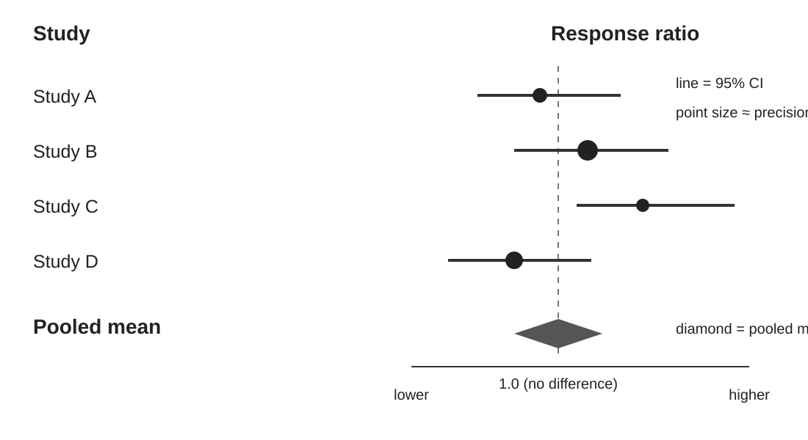
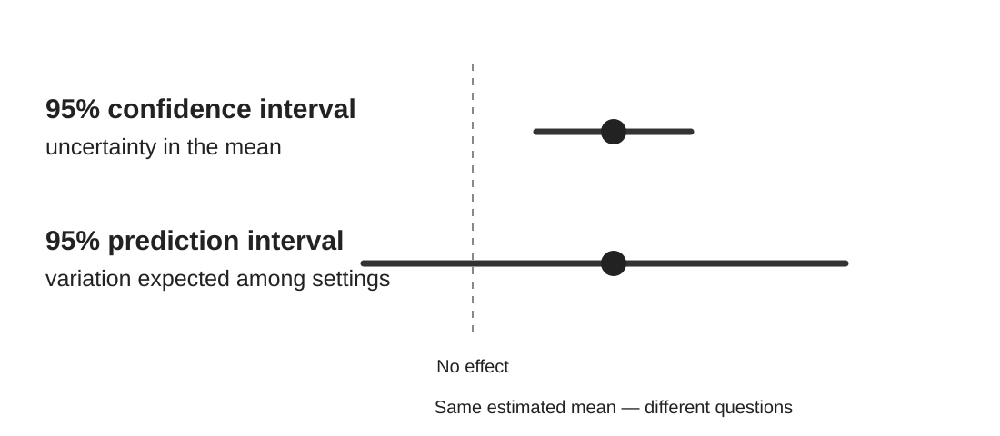

## From effects to synthesis

<div class="flow">
<div>Effect sizes</div><div class="arrow">→</div><div>Precision</div><div class="arrow">→</div><div>Model</div><div class="arrow">→</div><div>Mean + variation</div>
</div>

<div class="key fragment">Pooling is a model-based summary, not a vote.</div>

::: {.notes}
Reconnect to Module 1. We now have effect estimates and sampling variances. The task is to synthesise them without losing sight of the scientific quantity the model is supposed to estimate.
:::

## Learning objectives

By the end of this module, you should be able to:

::: {.incremental}
- explain why simple averaging is usually inappropriate;
- distinguish common-effect and random-effects assumptions;
- fit a random-effects model using `metafor`;
- read a forest plot;
- distinguish confidence and prediction intervals;
- translate a pooled lnRR into an interpretable result.
:::

::: {.notes}
Keep returning to the estimand. A model is useful only insofar as its assumptions correspond to the scientific quantity we want to estimate.
:::

## Why not just average?

::: {.columns}
::: {.column width="48%"}
<div class="card">
<strong>Study A</strong>
$n=200$<br>
small sampling variance
</div>
:::
::: {.column width="48%"}
<div class="card">
<strong>Study B</strong>
$n=10$<br>
large sampling variance
</div>
:::
:::

<div class="question fragment">Should these contribute equally to our estimate of the mean effect?</div>

::: {.notes}
The larger study is not necessarily better; it is more statistically precise. Bias, relevance and precision remain separate issues.
:::

## Two reasons observed effects differ

<div class="cards">
<div class="card"><strong>Sampling variation</strong>Repeat the same underlying study and estimates will still vary.</div>
<div class="card"><strong>Between-study heterogeneity</strong>Underlying effects may genuinely differ among soils, climates, crops or implementations.</div>
<div class="card"><strong>Observed variation</strong>What we see contains both sources.</div>
</div>

::: {.notes}
Use the field-trial analogy: repeat exactly the same trial many times and estimates vary because of sampling. Move it between climates and soils and the underlying effect may vary too.
:::

## Common-effect or random-effects?

::: {.columns}
::: {.column width="50%"}
### Common-effect

One underlying effect for the included studies.

Observed differences arise from sampling error.
:::
::: {.column width="50%"}
### Random-effects

Underlying effects may differ.

Estimate their mean **and** between-study variation.
:::
:::

<div class="warning fragment">Random effects do not make scientifically incompatible studies compatible.</div>

::: {.notes}
Avoid presenting random effects as the automatic answer to heterogeneity. If studies estimate fundamentally different quantities, adding tau-squared does not rescue the estimand.
:::

## The model in two lines

$$y_i=\theta_i+e_i$$

$$\theta_i=\mu+u_i$$

::: {.columns}
::: {.column width="50%"}
$e_i$ = sampling error
:::
::: {.column width="50%"}
$u_i$ = between-study deviation
:::
:::

<div class="key fragment">We want $\mu$, but we also care about the spread around it.</div>

::: {.notes}
Keep notation light. The point is to separate within-study sampling error from variation among underlying study effects. Module 3 will unpack that spread.
:::

## Fit the model

```{r}
#| eval: false
library(metafor)

soil <- read.csv("../data/teaching/soil_carbon.csv")

es <- escalc(
  measure = "ROM",
  m1i = mean_reduced, sd1i = sd_reduced, n1i = n_reduced,
  m2i = mean_control, sd2i = sd_control, n2i = n_control,
  data = soil
)

m <- rma(yi, vi, data = es, method = "REML")
summary(m)
```

::: {.notes}
Explain REML briefly as a commonly used estimator of between-study variance. There is no need to compare all tau-squared estimators in this introductory module.
:::

## Don't read the output top-to-bottom

Start with four questions:

::: {.incremental}
1. **What is the estimated mean effect?**
2. **How uncertain is that mean?**
3. **How much do underlying effects vary?**
4. **What does this mean on the original, interpretable scale?**
:::

::: {.notes}
This is a deliberate antidote to reading every p-value printed by software. Participants should develop a hierarchy for interpretation.
:::

## Back-transform the mean

```{r}
#| eval: false
predict(m, transf = exp)
```

If the pooled $RR=1.10$:

> Soil organic carbon is estimated to be **10% higher on average** under reduced tillage than conventional tillage **in the evidence represented by the model**.

::: {.notes}
The final phrase matters. “Reduced tillage increases soil carbon by 10%” is a stronger causal and general claim that may not be justified by the designs or target population.
:::

## Forest plot: read the evidence, not just the diamond

A forest plot shows:

::: {.incremental}
- each effect estimate;
- uncertainty around each estimate;
- relative statistical precision;
- the pooled estimate;
- sometimes a prediction interval.
:::

<div class="key fragment">Look at the distribution before looking at the summary.</div>

::: {.notes}
Ask where participants' eyes go first. Many people jump to the pooled diamond or count intervals crossing the null. Encourage them to inspect magnitude, precision and variation across studies first.
:::

## Anatomy of a forest plot

::: {.figure-frame}
{fig-alt="Conceptual forest plot showing individual study estimates and confidence intervals, a no-effect line at response ratio 1, and a pooled estimate represented by a diamond."}
:::

::: {.notes}
Read this from the studies outward, not from the diamond backward. Point estimates show magnitude and direction; horizontal lines show uncertainty; point size commonly reflects statistical precision; the diamond summarises the modelled mean. Crossing the null is not a label for whether an individual study 'worked'.
:::

## Create the forest plot

```{r}
#| eval: false
forest(
  m,
  slab = paste(es$study_id, es$effect_id, sep = "."),
  atransf = exp,
  xlab = "Response ratio (reduced / conventional)"
)

abline(v = 1, lty = 2)
```

::: {.columns}
::: {.column width="33%"}
**RR = 1**  
no proportional difference
:::
::: {.column width="33%"}
**RR > 1**  
higher under reduced tillage
:::
::: {.column width="33%"}
**RR < 1**  
lower under reduced tillage
:::
:::

::: {.notes}
`atransf = exp` displays results on the ratio scale while the analysis remains on lnRR. That gives interpretable labels without changing the fitted model.
:::

## Confidence interval: uncertainty in the mean

<div class="center big">How precisely have we estimated $\mu$?</div>

A 95% confidence interval describes uncertainty around the estimated **mean underlying effect**.

<div class="warning fragment">It does not describe the likely effect in a new setting.</div>

::: {.notes}
A precise mean can coexist with substantial variation among true effects. This is one of the most important distinctions in applied meta-analysis.
:::

## Prediction interval: variation across settings

<div class="center big">What underlying effect might occur in a comparable new setting?</div>

Conceptually:

$$\hat\mu \pm t\sqrt{SE(\hat\mu)^2+\hat\tau^2}$$

<div class="fragment question">If the CI excludes no effect but the prediction interval spans benefit and harm, what should a decision-maker hear?</div>

::: {.notes}
Say “comparable new setting” deliberately. Prediction intervals do not license extrapolation beyond the populations and contexts represented by the evidence.
:::

## See the difference: CI versus PI

::: {.figure-frame}
{fig-alt="Diagram contrasting a narrow confidence interval around the mean effect with a wider prediction interval representing variation among comparable settings."}
:::

::: {.notes}
Keep the centre fixed and point to the different widths. The confidence interval asks how well we know the mean. The prediction interval adds estimated between-study variation and asks about an underlying effect in a comparable setting. This distinction is often more useful than another significance test.
:::

## Same mean, very different message

::: {.columns}
::: {.column width="50%"}
<div class="card">
<strong>Evidence base A</strong>
Mean RR = 1.10<br>
PI = 1.04–1.16

Effects are relatively consistent.
</div>
:::
::: {.column width="50%"}
<div class="card">
<strong>Evidence base B</strong>
Mean RR = 1.10<br>
PI = 0.82–1.48

Effects vary substantially.
</div>
:::
:::

<div class="key fragment">The pooled mean alone cannot distinguish these stories.</div>

::: {.notes}
These are illustrative numbers. Ask which evidence base is easier to use for a local decision and what extra information would be useful for B.
:::

## Don't vote count the forest plot

<div class="warning">
<strong>Avoid:</strong> “8 of 12 studies found a significant positive effect.”
</div>

That discards:

::: {.incremental}
- magnitude;
- precision;
- uncertainty;
- between-study variation.
:::

<div class="key fragment">Synthesis uses the estimates and their uncertainty directly.</div>

::: {.notes}
Distinguish narrative description from vote counting. It is fine to describe the pattern and direction of effects. Tallying statistical significance is not an appropriate synthesis method.
:::

## A better results sentence

Instead of:

> “Most studies were significant, therefore reduced tillage works.”

Try:

> “Across the included evidence, the estimated mean response was X%, with a 95% CI of … . Underlying effects varied, with a prediction interval of … .”

<div class="fragment question">What would you add before making a management recommendation?</div>

::: {.notes}
Likely additions: study design/risk of bias, applicability, contexts represented, uncertainty, possible effect modifiers, outcomes and trade-offs. This keeps statistical synthesis connected to evidence appraisal.
:::

## Practical 2 — Your first model

Open `exercises/02-first-meta-analysis.qmd`.

<div class="flow">
<div>Fit</div><div class="arrow">→</div><div>Plot</div><div class="arrow">→</div><div>Predict</div><div class="arrow">→</div><div>Explain</div>
</div>

**Final task:** explain the result to a policy colleague without using “statistically significant” as the conclusion.

::: {.notes}
Allow 25–35 minutes. Encourage pairs to compare their final wording. The interpretation is at least as important as successfully running the code.
:::

## Take-home

<div class="key">A pooled mean is one feature of a distribution of effects.</div>

A useful synthesis communicates:

**mean + uncertainty + variation + scope**

::: {.notes}
Transition to Module 3: we have deliberately mentioned variation without examining it closely. Now we ask what heterogeneity actually means and how to communicate it.
:::
