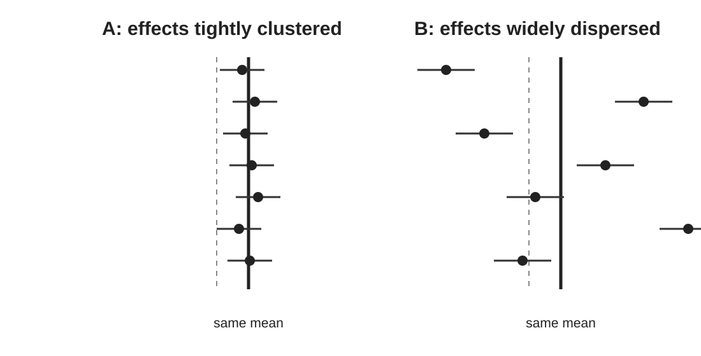

## The average can hide the decision problem

<div class="center big">
+30% &nbsp; +25% &nbsp; +20% &nbsp; +5% &nbsp; 0% &nbsp; −10%
</div>

<div class="question fragment">The average is positive. Is “the intervention increases the outcome” an adequate summary?</div>

::: {.notes}
Give participants a moment. A farmer or policymaker may care more about where the intervention works, whether it can fail, and whether their context resembles the evidence base. This is the scientific motivation for heterogeneity.
:::

## Learning objectives

By the end of this module, you should be able to:

::: {.incremental}
- explain heterogeneity in scientific rather than purely statistical terms;
- distinguish $\tau^2$, $\tau$ and $I^2$;
- interpret a prediction interval;
- explain why $I^2$ is not a quality score;
- identify plausible sources of heterogeneity;
- recognise when an average effect is insufficient.
:::

::: {.notes}
Start from the idea that observed estimates would differ even if the underlying effect were identical because of sampling variation. Heterogeneity is variation in underlying effects beyond that sampling variation.
:::

## In agri-food research, variation is expected

<div class="cards">
<div class="card"><strong>Environment</strong>climate · soil · baseline condition</div>
<div class="card"><strong>Management</strong>intensity · duration · implementation</div>
<div class="card"><strong>System</strong>crop · livestock · landscape context</div>
</div>

<div class="key fragment">Context dependence may be the scientific result.</div>

::: {.notes}
Avoid presenting heterogeneity as a nuisance or failure. For many management interventions, understanding context dependence is precisely what users need from the synthesis.
:::

## Three quantities — three different questions

<div class="cards">
<div class="card"><strong>$\tau^2$</strong>How much between-study variance is estimated?<br><span class="muted">Squared effect-size units</span></div>
<div class="card"><strong>$\tau$</strong>What is the SD of underlying effects?<br><span class="muted">Same scale as the analysed effect</span></div>
<div class="card"><strong>$I^2$</strong>How large is heterogeneity relative to observed sampling variation?<br><span class="muted">A relative percentage</span></div>
</div>

::: {.notes}
This slide is the map. The next slides unpack each quantity. Stress that none is a universal measure of “how bad” the meta-analysis is.
:::

## $\tau^2$: between-study variance

$$\theta_i \sim N(\mu,\tau^2)$$

$\tau^2$ is the estimated variance among underlying study effects.

<div class="question fragment">Useful for modelling — but are squared effect-size units easy to interpret?</div>

::: {.notes}
Tau-squared is the parameter commonly printed by software and used in random-effects weights. Its squared units make direct substantive interpretation awkward.
:::

## $\tau$: put spread back on the effect-size scale

$$\tau=\sqrt{\tau^2}$$

For lnRR, $\tau$ is the SD of underlying effects **on the log-ratio scale**.

<div class="warning fragment">There is no universal “small / medium / large” threshold for $\tau$.</div>

::: {.notes}
The substantive importance of tau depends on the effect scale and the decision context. A particular amount of variation may be trivial for one outcome and decisive for another.
:::

## $I^2$: relative, not absolute

A common description is the proportion of observed variation attributable to heterogeneity rather than sampling variation.

But $I^2$ depends on:

::: {.incremental}
- between-study heterogeneity; **and**
- the precision of the included studies.
:::

<div class="key fragment">The same $\tau^2$ can coexist with different $I^2$ values.</div>

::: {.notes}
This is why I-squared is not a direct measure of biological variability. More precise studies can yield a high I-squared even when absolute between-study variation is modest.
:::

## $I^2$ is not a traffic light

<div class="warning">
<strong>Be cautious:</strong> 25% = low · 50% = moderate · 75% = high
</div>

Those labels do not tell us whether variation is **scientifically important**.

<div class="question fragment">Could the plausible range of effects change the decision?</div>

::: {.notes}
Do not tell participants never to report I-squared. It can be useful descriptive information. The problem is converting generic thresholds into substantive conclusions.
:::

## Prediction intervals make variation tangible

Suppose:

<div class="center big">
Mean RR = **1.10**  
95% prediction interval = **0.82–1.48**
</div>

<div class="fragment question">A comparable setting could plausibly show a decrease or a substantial increase. Is the mean enough?</div>

::: {.notes}
These values are illustrative rather than outputs from the teaching dataset. Ask which interval—CI or PI—is more relevant to someone deciding whether to implement the intervention locally.
:::

## Confidence interval ≠ prediction interval

::: {.columns}
::: {.column width="50%"}
### Confidence interval

**How uncertain is our estimate of the mean effect?**
:::
::: {.column width="50%"}
### Prediction interval

**What underlying effect might occur in a comparable new setting?**
:::
:::

<div class="key fragment">Different questions → different intervals.</div>

::: {.notes}
A narrow confidence interval does not imply effects are consistent. The mean can be precisely estimated while true effects vary widely.
:::

## Inspect heterogeneity in `metafor`

```{r}
#| eval: false
m <- rma(yi, vi, data = es, method = "REML")

m$tau2
sqrt(m$tau2)
m$I2

predict(m, transf = exp)
```

<div class="key fragment">Don't copy these numbers into a paper. Interpret them together.</div>

::: {.notes}
For lnRR, back-transform pooled and predicted effects to response ratios before explaining them. Keep the distinction between the modelling scale and the communication scale clear.
:::

## Ask “why might effects differ?” before testing moderators

<div class="cards">
<div class="card"><strong>Biology</strong>rainfall · soil texture · crop · baseline carbon</div>
<div class="card"><strong>Implementation</strong>duration · intensity · co-interventions</div>
<div class="card"><strong>Methods</strong>measurement · design · analysis · risk of bias</div>
</div>

::: {.notes}
Ask participants to nominate plausible effect modifiers before inspecting associations. This encourages hypothesis-led analysis rather than searching through variables after seeing the data.
:::

## Not all heterogeneity is ecological signal

Variation can arise from:

::: {.incremental}
- different outcome definitions;
- measurement methods;
- study designs;
- analytical choices;
- selective reporting;
- risk of bias.
:::

<div class="warning fragment">Explaining heterogeneity requires subject-matter and methodological judgement.</div>

::: {.notes}
A meta-regression association with study design might indicate bias rather than a biological modifier. Statistical explanation is not automatically causal explanation.
:::

## Should we explain every bit of heterogeneity?

**No.** Meta-regression is most useful when moderators are:

::: {.incremental}
- scientifically motivated;
- measured reasonably well;
- represented across enough studies;
- specified without excessive data dredging.
:::

<div class="key fragment">Residual heterogeneity is normal.</div>

::: {.notes}
Foreshadow Module 5. Small meta-analyses contain little information for moderator effects. The goal is not to keep adding variables until tau-squared approaches zero.
:::

## Same mean does not mean same evidence

::: {.figure-frame}
{fig-alt="Two conceptual meta-analyses with the same mean effect but one with tightly clustered study effects and one with widely dispersed effects."}
:::

<div class="check fragment">If you report only the pooled mean, these evidence bases look the same.</div>

::: {.notes}
This is the visual anchor for the module. Both panels have the same vertical mean line. In A, effects cluster around it. In B, the mean hides substantial context dependence. Ask which panel makes the pooled mean more portable to a new setting and why.
:::

## Same mean, different decisions

::: {.columns}
::: {.column width="50%"}
<div class="card">
<strong>Scenario A</strong><br>
Mean benefit ≈ 10%<br>
Effects tightly clustered around benefit
</div>
:::
::: {.column width="50%"}
<div class="card">
<strong>Scenario B</strong><br>
Mean benefit ≈ 10%<br>
Effects range from meaningful harm to large benefit
</div>
:::
:::

<div class="question fragment">What information would you seek before applying Scenario B locally?</div>

::: {.notes}
Expected answers include context, moderators, study design, applicability, baseline conditions and uncertainty. The point is to connect heterogeneity to decisions rather than to a diagnostic threshold.
:::

## A reporting checklist

A useful account of heterogeneous evidence may include:

::: {.incremental}
- pooled mean effect + confidence interval;
- $\tau^2$ or $\tau$;
- $I^2$ as descriptive context;
- prediction interval;
- forest plot / distribution of effects;
- plausible effect modifiers;
- limitations in applicability and evidence quality.
:::

::: {.notes}
The exact package depends on the evidence base. The principle is to communicate centre and spread, and to separate statistical variation from claims about why that variation occurs.
:::

## Practical 3 — Tell the scientific story

Open `exercises/03-heterogeneity.qmd`.

You will compare meta-analyses with similar means but different heterogeneity, then inspect the soil-carbon example.

<div class="question fragment">
<strong>Final task:</strong> write four sentences for a decision-maker without using “low”, “moderate” or “high” heterogeneity.
</div>

::: {.notes}
If time is short, prioritise the final interpretation task over extra calculations. Ask pairs to read their four sentences aloud and compare what information they chose to foreground.
:::

## Take-home

<div class="key">Heterogeneity is not a nuisance statistic attached to the pooled effect.</div>

A useful synthesis communicates:

<div class="center big">**centre + uncertainty + variation + context**</div>

::: {.notes}
End by returning to the question from Module 0. Would a single average effect answer it? What additional information would participants now want before using the synthesis for a decision?
:::
