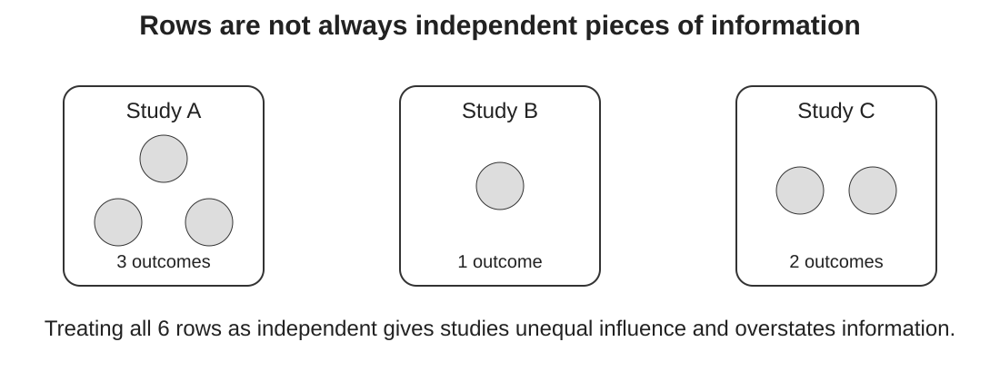

## One paper does not always mean one effect

A study may report several:

::: {.incremental}
- outcomes;
- treatment levels;
- time points;
- sites;
- comparisons sharing the same control;
- effect sizes calculated from the same participants or plots.
:::

<div class="key fragment">More rows ≠ more independent information.</div>

::: {.notes}
Ask participants how often they have extracted more than one effect from a paper. In agri-food evidence this is routine: several soil depths, crops, treatments, outcomes or follow-up times. The problem is not multiple outcomes themselves; it is pretending that their sampling errors and underlying effects are unrelated.
:::

## Learning objectives

By the end of this module, you should be able to:

::: {.incremental}
- recognise common forms of dependence in meta-analysis;
- explain why naive independence can distort precision and weighting;
- distinguish study-level and effect-level variation;
- fit a simple multilevel model with `rma.mv()`;
- identify when a sampling variance–covariance matrix may be needed;
- explain what a multilevel model does **not** solve.
:::

## Six rows — three studies

::: {.figure-frame}
{fig-alt="Three studies contributing different numbers of outcomes, illustrating that six effect-size rows are not six independent studies."}
:::

::: {.notes}
The key point is unequal information. If Study A contributes three highly related outcomes and Study B contributes one, simply treating all four as independent lets A count roughly three times. It can also make standard errors too small because correlation is ignored.
:::

## Where does dependence come from?

<div class="cards">
<div class="card"><strong>Shared units</strong>Several outcomes measured on the same plots, farms or animals.</div>
<div class="card"><strong>Shared comparator</strong>Several interventions compared with the same control group.</div>
<div class="card"><strong>Repeated measurement</strong>The same outcome measured at several times or depths.</div>
</div>

<div class="question fragment">Which of these would you expect in your own evidence base?</div>

::: {.notes}
Invite examples. Make clear that study ID is not a magic definition of dependence: dependence arises from shared information and design. The study is often a useful clustering unit, but analysts need to understand how the effects were generated.
:::

## What goes wrong if we ignore it?

Treating correlated effects as independent can:

::: {.incremental}
- give studies with many outcomes disproportionate weight;
- underestimate uncertainty;
- produce confidence intervals that are too narrow;
- obscure variation within versus between studies;
- make moderator tests look more informative than they are.
:::

<div class="warning fragment">The pooled estimate itself may also shift when prolific studies differ systematically from the rest.</div>

::: {.notes}
Avoid saying that dependence always causes the same bias direction. The most predictable problem is incorrect uncertainty and weighting. The point estimate can also change because studies contributing many effects get more influence.
:::

## Three common responses

<div class="cards">
<div class="card"><strong>Choose one effect</strong>Simple, but may discard relevant evidence and requires a defensible rule.</div>
<div class="card"><strong>Combine effects</strong>Useful when effects genuinely answer the same question and covariance can be handled.</div>
<div class="card"><strong>Model dependence</strong>Retain multiple effects and represent their structure explicitly.</div>
</div>

<div class="key fragment">The choice should follow the estimand and data-generating structure.</div>

::: {.notes}
This links back to Module 0. Selecting one effect is not automatically wrong. Sometimes it is exactly what the estimand requires. The bad practice is choosing outcomes opportunistically after seeing results.
:::

## A simple multilevel model

For effect $j$ within study $i$:

$$y_{ij}=\mu+u_i+v_{ij}+e_{ij}$$

::: {.incremental}
- $\mu$: average effect
- $u_i$: between-study deviation
- $v_{ij}$: within-study heterogeneity among underlying effects
- $e_{ij}$: sampling error
:::

::: {.notes}
Keep the notation intuitive. We are decomposing why observed effects differ. Sampling error is already represented by vi; random effects describe heterogeneity at additional levels.
:::

## Fit it with `rma.mv()`

```{r}
#| eval: false
m_mv <- rma.mv(
  yi, vi,
  random = ~ 1 | study_id/effect_id,
  data = es,
  method = "REML"
)

summary(m_mv)
```

<div class="key fragment">The nesting tells the model that effects are grouped within studies.</div>

::: {.notes}
Explain the formula as study/effect, not as mysterious metafor syntax. In a real dataset, effect_id must uniquely identify effects within study. Compare this with the earlier rma() model that treated rows as independent.
:::

## Read the variance components

A multilevel model may estimate variation:

::: {.incremental}
1. **between studies** — contexts differ;
2. **within studies** — outcomes/comparisons differ within the same study;
3. **sampling error** — observed estimates are noisy.
:::

<div class="question fragment">Which source of variation is scientifically interesting in your review?</div>

::: {.notes}
Do not make variance decomposition purely technical. A large within-study component may indicate outcome-specific effects or treatment contrasts. A large between-study component may point to contextual variation. Interpretation depends on what each row represents.
:::

## But random effects do not create missing covariance

If two estimates share participants or a control group, their **sampling errors may be correlated**.

A multilevel random-effects structure and a sampling covariance matrix address related but different problems.

```{r}
#| eval: false
# Conceptual form when a sampling V matrix is available
m_v <- rma.mv(
  yi,
  V = V,
  random = ~ 1 | study_id/effect_id,
  data = es
)
```

::: {.notes}
This is an important sophistication. The simple exercise uses vi because we do not know the sampling correlations. Make explicit that adding a study random effect does not magically reconstruct correlations induced by a shared control or repeated measures. Later analyses may use known covariance formulas, plausible correlations, or robust variance methods.
:::

## What if correlations are unknown?

Possible strategies include:

::: {.incremental}
- obtain enough primary information to calculate covariance;
- make and vary a plausible correlation assumption;
- aggregate effects when scientifically justified;
- use cluster-robust inference where appropriate;
- test whether conclusions depend on the chosen strategy.
:::

<div class="warning fragment">“We do not know the correlation” is a reason for sensitivity analysis — not a reason to assume zero silently.</div>

::: {.notes}
Keep this as a map rather than a full robust variance estimation lesson. The course can point learners towards advanced resources. The key habit is to make the dependence assumption visible.
:::

## A useful diagnostic before modelling

```{r}
#| eval: false
with(es, table(study_id))

table(table(es$study_id))
```

Ask:

::: {.incremental}
- How many studies contribute >1 effect?
- Why do they contribute more?
- Do prolific studies differ systematically?
- Which effects share data?
:::

::: {.notes}
This simple table is often surprisingly informative. Encourage participants to map the dependence structure during extraction rather than discovering it only when fitting the model.
:::

## What the model cannot fix

A multilevel model does **not** automatically fix:

::: {.incremental}
- biased primary studies;
- incompatible outcomes;
- selective outcome reporting;
- badly measured moderators;
- confounding;
- extrapolation beyond represented settings.
:::

<div class="key fragment">A more complex model cannot rescue an incoherent synthesis question.</div>

::: {.notes}
Connect back to critical appraisal and estimands. Statistical sophistication is not a substitute for design judgement.
:::

## Take-home message

<div class="flow">
<div>Map the<br>dependence</div><div class="arrow">→</div>
<div>Decide what<br>belongs together</div><div class="arrow">→</div>
<div>Model or<br>combine it</div><div class="arrow">→</div>
<div>Test key<br>assumptions</div>
</div>

<div class="key fragment">Dependence is a feature of the evidence — not an inconvenience to delete.</div>

::: {.notes}
Transition to Module 5: once the dependence structure is represented, we can ask whether prespecified study characteristics explain some of the remaining heterogeneity.
:::
