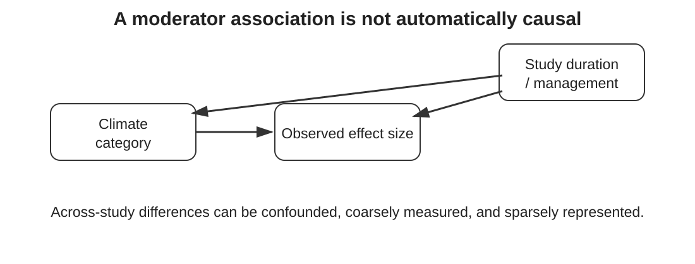

## Heterogeneity invites a better question

Instead of:

> “Is heterogeneity significant?”

ask:

<div class="question fragment">Which scientifically plausible characteristics might explain why effects differ?</div>

::: {.notes}
Module 3 established that heterogeneity may be substantive information. Here we move from describing variation to asking whether measured study characteristics are associated with it.
:::

## Learning objectives

By the end of this module, you should be able to:

::: {.incremental}
- distinguish subgroup analysis from meta-regression;
- fit categorical and continuous moderators;
- interpret coefficients on the lnRR and RR scales;
- distinguish within-study causal effects from across-study associations;
- recognise confounding, sparse data and multiplicity;
- use moderators for explanation without overclaiming.
:::

## Start with a hypothesis, not a variable list

For our soil-carbon example we might hypothesise:

::: {.incremental}
- effects strengthen with **intervention duration**;
- effects differ among **climate categories**;
- baseline soil properties modify response;
- management intensity changes the effect.
:::

<div class="key fragment">Specify the mechanism before inspecting the coefficient.</div>

::: {.notes}
Ask participants which hypotheses are biologically plausible and which variables the teaching dataset actually contains. A moderator should earn its place scientifically, not because it happened to be recorded.
:::

## Categorical moderators: subgroup differences

```{r}
#| eval: false
m_climate <- rma.mv(
  yi, vi,
  mods = ~ climate,
  random = ~ 1 | study_id/effect_id,
  data = es
)

summary(m_climate)
```

The intercept represents the reference category; other coefficients represent differences from it.

::: {.notes}
Make learners inspect factor coding with levels(es$climate). The coefficient is a difference on the log response-ratio scale, not a separate pooled effect unless transformed appropriately.
:::

## Continuous moderators: a slope

```{r}
#| eval: false
m_duration <- rma.mv(
  yi, vi,
  mods = ~ duration,
  random = ~ 1 | study_id/effect_id,
  data = es
)
```

$$y_i=\beta_0+\beta_1\text{duration}_i+u_i+e_i$$

<div class="question fragment">What does a one-year increase in duration mean on the lnRR scale?</div>

::: {.notes}
Beta1 is the expected change in lnRR per one-unit increase in duration. exp(beta1) is the multiplicative change in RR per year. Emphasise units. Rescaling duration to five years can sometimes make interpretation easier.
:::

## Back-transform the slope carefully

Suppose $\beta_1=0.025$ per year.

$$\exp(0.025)=1.025$$

That corresponds to approximately a **2.5% multiplicative increase in RR per additional year**, conditional on the model.

<div class="warning fragment">It does not mean that extending the same experiment by one year would necessarily cause a 2.5% larger effect.</div>

::: {.notes}
This distinction is crucial. The meta-regression compares studies with different durations. Longer-duration studies may differ in many other ways.
:::

## Meta-regression is usually observational across studies

::: {.figure-frame}
{fig-alt="Conceptual diagram showing that an association between climate category and observed effect can be confounded by other study characteristics such as duration or management."}
:::

::: {.notes}
Even if treatments were randomised within every primary study, duration, climate or study design generally were not randomised across studies. Meta-regression therefore does not inherit the causal protection of the treatment randomisation.
:::

## A familiar trap: across-study ≠ within-study

Imagine longer studies show larger effects.

Possible explanations include:

::: {.incremental}
- the effect truly accumulates with time;
- longer studies occur in different climates;
- different crops are studied for longer;
- older/longer studies use different methods;
- publication or follow-up processes differ.
:::

<div class="key fragment">Association can generate hypotheses without identifying the mechanism.</div>

::: {.notes}
This is ecological confounding at the study level. If some primary studies themselves randomised or compared duration, those within-study contrasts would answer a different and potentially stronger causal question.
:::

## How many moderators can the data support?

Meta-regression is often **information-poor**.

::: {.incremental}
- A meta-analysis with 12 studies does not become a rich regression dataset because it has 30 dependent effect sizes.
- Sparse categories yield unstable estimates.
- Multiple testing increases opportunities for chance findings.
- Moderator measurement error can attenuate associations.
:::

<div class="warning fragment">Avoid mechanical “10 studies per moderator” rules — but be appropriately modest with small evidence bases.</div>

::: {.notes}
There is no universal magic ratio. Precision depends on distributions, heterogeneity, dependence and effect sizes. The practical lesson is restraint, prespecification and honest uncertainty.
:::

## Multivariable models need a causal story too

```{r}
#| eval: false
m_both <- rma.mv(
  yi, vi,
  mods = ~ duration + climate,
  random = ~ 1 | study_id/effect_id,
  data = es
)
```

Adding covariates can change the estimand of each coefficient.

<div class="question fragment">Are we adjusting for a confounder, a proxy, a mediator, or merely an available variable?</div>

::: {.notes}
This is a light introduction to causal thinking, not a full DAG lesson. Encourage reviewers to articulate why each variable is included. “It reduced tau-squared” is not sufficient justification.
:::

## Residual heterogeneity is not model failure

After adding moderators, ask:

::: {.incremental}
- Is there evidence of an association?
- How uncertain is it?
- How much heterogeneity remains?
- Are predictions still variable across settings?
- Does the moderator cover the range where we want to predict?
:::

<div class="key fragment">The goal is understanding, not making $\tau^2$ disappear.</div>

::: {.notes}
Do not select a model simply because it explains the largest fraction of heterogeneity. A flexible model can overfit a small meta-analysis.
:::

## Extrapolation deserves a warning label

If durations in the evidence base range from **2–12 years**:

<div class="center big">Predict at 8 years? ✓ &nbsp;&nbsp;&nbsp; Predict at 30 years? ?</div>

<div class="warning fragment">A fitted line is mathematically happy to extrapolate where the evidence does not exist.</div>

::: {.notes}
This is particularly important for decision support. Show the observed moderator range alongside predictions. A linear trend may also be biologically implausible over long horizons.
:::

## Report the pattern, not just the p-value

A useful report includes:

::: {.incremental}
- the prespecified moderator and rationale;
- coefficient/effect estimate with uncertainty;
- units and reference category;
- number and distribution of studies;
- residual heterogeneity;
- limitations of across-study interpretation.
:::

<div class="key fragment">“Significant moderator” is not an interpretation.</div>

::: {.notes}
Encourage a plot whenever possible. Readers need to see where the data lie and whether an apparent trend is driven by one or two studies.
:::

## Take-home message

<div class="flow">
<div>Hypothesis</div><div class="arrow">→</div>
<div>Moderator<br>model</div><div class="arrow">→</div>
<div>Association +<br>uncertainty</div><div class="arrow">→</div>
<div>Cautious<br>interpretation</div>
</div>

<div class="key fragment">Meta-regression can describe context dependence. It does not automatically explain its cause.</div>

::: {.notes}
Transition to Module 6: every synthesis contains analytical choices. We now ask whether the substantive conclusion is robust to reasonable alternatives and influential evidence.
:::
