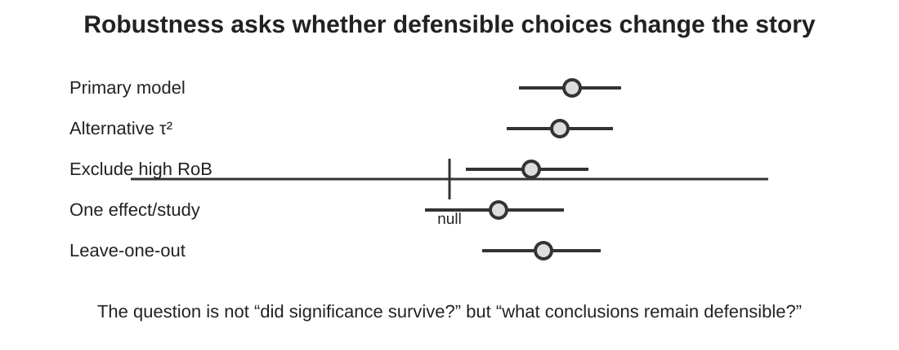

## Every meta-analysis contains choices

Examples include:

::: {.incremental}
- eligibility decisions;
- effect-size definitions;
- handling of dependence;
- heterogeneity estimators;
- moderator specification;
- treatment of high-risk-of-bias studies;
- assumptions about missing correlations.
:::

<div class="question fragment">Would another defensible choice change what we tell the decision-maker?</div>

::: {.notes}
Frame sensitivity analysis as part of the scientific argument. It is not a ritual performed after the primary model and it is not restricted to leave-one-out diagnostics.
:::

## Learning objectives

By the end of this module, you should be able to:

::: {.incremental}
- distinguish sensitivity analysis from influence diagnostics;
- identify assumptions worth varying;
- use leave-one-out and influence diagnostics appropriately;
- compare defensible model specifications;
- incorporate risk of bias into sensitivity analyses;
- report robustness without reducing it to significance/no significance.
:::

## Start with the assumptions that could matter

<div class="cards">
<div class="card"><strong>Evidence</strong>Which studies/effects belong in the synthesis?</div>
<div class="card"><strong>Measurement</strong>How were outcomes converted to a common effect?</div>
<div class="card"><strong>Model</strong>How were heterogeneity and dependence represented?</div>
</div>

<div class="key fragment">Sensitivity analysis should target plausible sources of uncertainty.</div>

::: {.notes}
Ask participants to list three decisions they made before fitting their own most recent meta-analysis. Those are candidates for sensitivity analysis if reasonable alternatives exist.
:::

## Influence diagnostics answer a narrower question

> Is the fitted result unusually dependent on one study or effect?

```{r}
#| eval: false
m <- rma(yi, vi, data = es, method = "REML")

leave1out(m)
influence(m)
```

<div class="warning fragment">An influential study is not automatically a bad study.</div>

::: {.notes}
Influence is a property of the dataset/model combination. A large, precise or unusual study may legitimately be influential. Do not delete studies merely because a diagnostic flags them.
:::

## Leave-one-out: what are we looking for?

For each omitted study/effect, examine changes in:

::: {.incremental}
- pooled magnitude;
- uncertainty;
- prediction interval;
- heterogeneity;
- substantive interpretation.
:::

<div class="key fragment">Do not ask only whether $p$ crosses 0.05.</div>

::: {.notes}
A result moving from p=.04 to p=.06 with essentially the same estimate is not a dramatic lack of robustness. Conversely, a conclusion can remain statistically significant while changing enough in magnitude to matter for decisions.
:::

## Robustness is about the conclusion

::: {.figure-frame}
{fig-alt="Conceptual robustness plot showing estimates under a primary model and several defensible alternative analyses relative to the null."}
:::

::: {.notes}
Use this as the anchor. Some estimates move more than others. Ask participants whether the overall story is stable and what would need to be reported. The point is not to demand identical results.
:::

## Model-specification sensitivity

Examples:

```{r}
#| eval: false
m_reml <- rma(yi, vi, data = es, method = "REML")
m_pm   <- rma(yi, vi, data = es, method = "PM")

m_mv <- rma.mv(
  yi, vi,
  random = ~ 1 | study_id/effect_id,
  data = es,
  method = "REML"
)
```

<div class="question fragment">Which alternatives are scientifically defensible for *this* evidence base?</div>

::: {.notes}
Do not encourage a kitchen-sink multiverse for its own sake. Compare alternatives that represent genuine uncertainty in the analysis. The estimator example is useful pedagogically, but dependence and eligibility decisions may matter far more.
:::

## Sensitivity to dependence assumptions

If a sampling correlation is unknown, we might repeat the analysis across plausible values:

<div class="center big">$\rho = 0.2$ &nbsp;&nbsp; 0.5 &nbsp;&nbsp; 0.8</div>

Then ask whether estimates and uncertainty materially change.

<div class="key fragment">Make the unobserved assumption visible.</div>

::: {.notes}
This links directly to Module 4. Do not imply these three rho values are universally appropriate; the plausible range must come from the design and subject matter.
:::

## Risk of bias belongs in robustness thinking

Possible approaches include:

::: {.incremental}
- primary analysis using all eligible evidence, with RoB clearly characterised;
- sensitivity analysis excluding studies with specified high-risk features;
- stratification/meta-regression where justified and adequately powered;
- interpretation that gives greater weight to more credible evidence.
:::

<div class="warning fragment">A numerical “quality score” is not a substitute for domain-level critical appraisal.</div>

::: {.notes}
Emphasise prespecification. Excluding inconvenient studies after seeing their results is not a credible sensitivity analysis. Risk-of-bias domains should reflect mechanisms by which estimates could be biased.
:::

## What if the conclusion changes?

That is **information**, not analytical failure.

::: {.incremental}
- Identify which assumption drives the change.
- Explain why both analyses are defensible—or why one is preferred.
- Report the range of plausible conclusions.
- Avoid choosing the specification because it gives the desired answer.
:::

<div class="key fragment">Fragility is itself a result.</div>

::: {.notes}
This is an important cultural point. Sensitivity analysis is valuable precisely when it reveals that the conclusion depends on uncertain assumptions.
:::

## What if nothing changes?

Robustness increases confidence **with respect to the assumptions tested**.

It does not prove absence of:

::: {.incremental}
- publication bias;
- unmeasured confounding;
- outcome reporting bias;
- measurement error;
- poor external validity.
:::

<div class="warning fragment">Robust to tested alternatives ≠ universally trustworthy.</div>

::: {.notes}
Avoid overclaiming from robustness. Sensitivity analyses are conditional checks, not validation of the whole evidence base.
:::

## A compact reporting structure

> The primary model estimated **X**. Results were similar when **A** and **B** were varied, but excluding studies with **C** shifted the estimate to **Y** and increased uncertainty. Conclusions are therefore robust to **A/B**, but sensitive to assumptions about **C**.

::: {.notes}
This is a template, not wording to copy mechanically. It forces authors to state what changed and what did not, rather than dumping a supplementary table of alternative models.
:::

## Take-home message

<div class="flow">
<div>Identify consequential<br>assumptions</div><div class="arrow">→</div>
<div>Specify defensible<br>alternatives</div><div class="arrow">→</div>
<div>Compare estimates +<br>uncertainty</div><div class="arrow">→</div>
<div>Report what is<br>stable or fragile</div>
</div>

<div class="key fragment">Sensitivity analysis asks how much our conclusion depends on choices we could reasonably have made differently.</div>

::: {.notes}
Transition to Module 7: one major threat cannot be solved simply by refitting the observed evidence—studies and outcomes that are missing because of selective reporting.
:::
