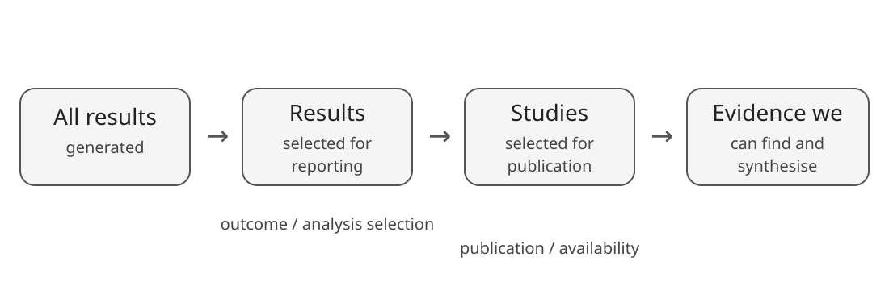
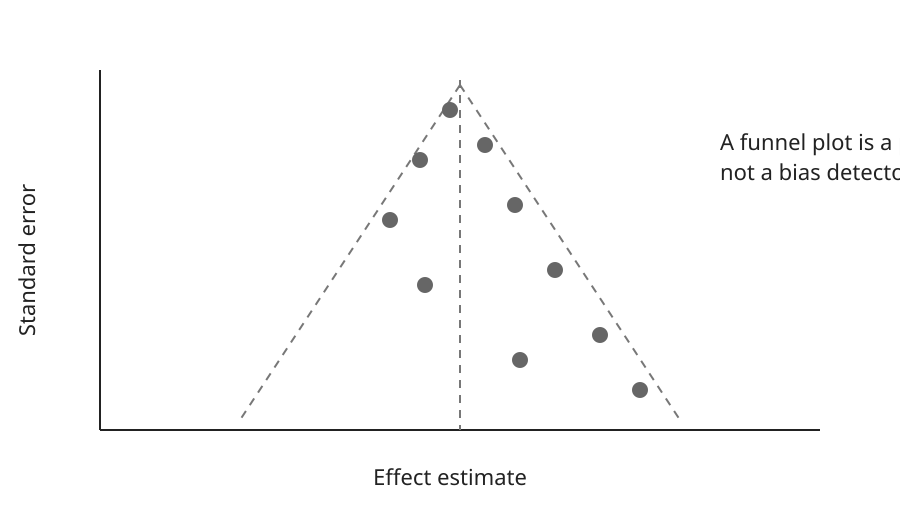

## The meta-analysis only sees available evidence

::: {.figure-frame}
{fig-alt="Flow from all generated results through selective reporting and publication to the evidence available for synthesis."}
:::

<div class="key fragment">Missingness can occur at the study, outcome, analysis and result level.</div>

::: {.notes}
Begin with the mechanism rather than a funnel plot. Ask: what has to happen between collecting data and a result appearing in our review? Distinguish non-publication of whole studies from selective reporting within studies. In agri-food research, grey literature, reports and multiple outcomes can make availability especially complicated.
:::

## Learning objectives

By the end of this module, you should be able to:

::: {.incremental}
- distinguish publication bias from broader selective reporting;
- explain what funnel plots and small-study-effect tests can and cannot show;
- recognise plausible alternative causes of funnel asymmetry;
- use diagnostics cautiously in R;
- combine statistical diagnostics with review-process information;
- communicate uncertainty about missing evidence without claiming it has been “corrected”.
:::

## Publication bias is only one mechanism

<div class="cards">
<div class="card"><strong>Study publication</strong><br>Whether an entire study becomes available.</div>
<div class="card"><strong>Outcome reporting</strong><br>Which measured outcomes appear in the report.</div>
<div class="card"><strong>Analysis reporting</strong><br>Which time points, contrasts or models are shown.</div>
</div>

<div class="question fragment">Could availability depend on the direction, magnitude or statistical significance of the result?</div>

::: {.notes}
Use “reporting bias” as the umbrella idea. A published paper does not guarantee that every measured outcome or analysis is available. Ask participants for examples: yield reported but soil carbon omitted; only one follow-up time; subgroup reported after seeing results.
:::

## Why this matters for meta-analysis

If the probability that an estimate is observed depends on its result, then the observed evidence may not represent the evidence that was generated.

Possible consequences include:

::: {.incremental}
- biased pooled effects;
- distorted heterogeneity;
- misleading moderator relationships;
- overconfidence in the apparent evidence base.
:::

<div class="warning fragment">A larger meta-analysis is not necessarily a less biased meta-analysis.</div>

::: {.notes}
Emphasise that increasing k does not solve systematic selection. Missing evidence is about the data-generating and reporting process, not merely sample size.
:::

## Funnel plots: what are they showing?

::: {.figure-frame}
{fig-alt="Conceptual funnel plot with effect estimate on the horizontal axis and standard error on the vertical axis."}
:::

::: {.notes}
A funnel plot visualises the relationship between effect estimates and their precision. In the absence of several complications, estimates from smaller studies are expected to scatter more widely. Do not teach symmetry as a formal null expectation that diagnoses publication bias.
:::

## Asymmetry has many possible causes

::: {.incremental}
- selective publication or reporting;
- genuine differences between small and large studies;
- study quality or design differences;
- different interventions, populations or settings;
- effect-size/variance relationships;
- chance, especially with few studies.
:::

<div class="key fragment">Funnel asymmetry is a clue to investigate, not a diagnosis.</div>

::: {.notes}
This is the core message. Small studies may genuinely be different—for example, intensive experimental interventions at research stations versus larger pragmatic field trials.
:::

## A funnel plot in `metafor`

```{r}
#| eval: false
m <- rma(yi, vi, data = es, method = "REML")
funnel(m)
```

Before interpreting the picture, ask:

::: {.incremental}
1. Are there enough independent studies for the pattern to be informative?
2. Could heterogeneity explain structure in the plot?
3. Are effect size and precision mathematically related?
4. Do study characteristics differ with study size?
:::

::: {.notes}
Do not offer a universal minimum k as a magic threshold. The point is that sparse plots are difficult to interpret and dependence further complicates them.
:::

## Small-study effects are not synonymous with publication bias

A regression-based test asks whether effect size is associated with precision or sampling variance.

```{r}
#| eval: false
regtest(m)
```

<div class="warning fragment">A detected small-study effect does not identify its cause.</div>

::: {.notes}
Explain that “Egger test = publication bias test” is an overstatement. The regression can detect a pattern consistent with small-study effects; selection is one possible explanation. Conversely, low power means a non-significant test cannot establish absence of bias.
:::

## What does a non-significant test tell us?

Not this:

> “There was no publication bias (p > 0.05).”

Better:

> “We found no clear evidence of a relationship between effect size and precision, but the analysis has limited ability to rule out selective reporting.”

::: {.notes}
Ask the group what evidence would be required to support the first sentence. This links back to the course-wide theme that absence of statistical significance is not evidence of absence.
:::

## What about trim-and-fill?

Trim-and-fill can be useful as an exploratory sensitivity analysis, but it relies on assumptions about funnel asymmetry that may not match the actual selection process.

```{r}
#| eval: false
m_tf <- trimfill(m)
funnel(m_tf)
```

<div class="warning fragment">Do not describe the filled estimate as the result “corrected for publication bias”.</div>

::: {.notes}
The method imputes hypothetical missing effects under a particular symmetry model. It does not recover unknown unpublished studies and does not establish why asymmetry occurred.
:::

## Start earlier than the statistical diagnostics

Review methods can provide direct clues:

::: {.incremental}
- search grey literature and relevant repositories;
- compare protocols/registrations with reports where available;
- record missing outcomes and unusable results;
- contact authors when important data are unavailable;
- document conference abstracts and unpublished studies;
- consider whether funding or dissemination pathways could affect availability.
:::

<div class="key fragment">Prevention and detection begin with the search and extraction process.</div>

::: {.notes}
This makes the module part of evidence synthesis rather than a collection of post-hoc tests. Statistical diagnostics operate only on what was observed.
:::

## Triangulate, do not tick a box

A useful assessment combines:

<div class="cards">
<div class="card"><strong>Review-process evidence</strong><br>What appears to be missing?</div>
<div class="card"><strong>Study characteristics</strong><br>Could size and design explain patterns?</div>
<div class="card"><strong>Statistical patterns</strong><br>Are small-study effects apparent?</div>
</div>

<div class="key fragment">The conclusion is an argument from multiple pieces of evidence.</div>

::: {.notes}
Avoid converting this into a score. The goal is transparent reasoning about mechanisms and consequences.
:::

## Reporting example

> Smaller studies tended to report larger effects, although study size was also associated with intervention duration and setting. Funnel-plot asymmetry and regression diagnostics therefore cannot be attributed uniquely to selective publication. Searches identified several reports with incomplete outcome information. We consider selective reporting a plausible source of bias and interpret the pooled estimate cautiously.

::: {.notes}
Point out the structure: observed pattern → competing explanation → direct review evidence → calibrated conclusion. It does not pretend the cause has been proven.
:::

## Take-home message

<div class="flow">
<div>Ask what could<br>be missing</div><div class="arrow">→</div>
<div>Investigate the<br>reporting process</div><div class="arrow">→</div>
<div>Use diagnostics<br>cautiously</div><div class="arrow">→</div>
<div>Triangulate +<br>report uncertainty</div>
</div>

<div class="key fragment">No funnel plot, test or adjustment can prove that the observed evidence is complete.</div>

::: {.notes}
Transition to Module 8. We now have all the ingredients—estimand, effect size, pooled effect, heterogeneity, dependence, moderators, robustness and missing evidence. The final task is to turn them into a conclusion that is useful without outrunning the evidence.
:::
