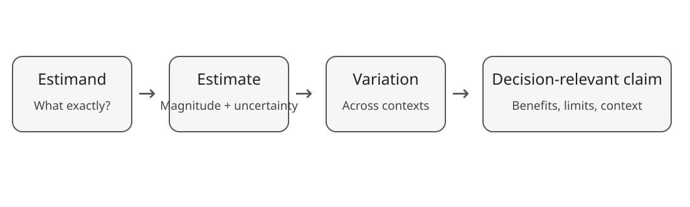

## A model output is not yet a conclusion

::: {.figure-frame}
{fig-alt="Flow from estimand through estimate and variation to a decision-relevant claim."}
:::

<div class="key fragment">Interpretation reconnects the statistical model to the question we promised to answer.</div>

::: {.notes}
Return explicitly to Module 0. A sophisticated model can still answer the wrong question. Ask participants what information, beyond the pooled estimate, they now think a conclusion needs.
:::

## Learning objectives

By the end of this module, you should be able to:

::: {.incremental}
- translate model output into substantive language;
- distinguish mean effects from expected variation across settings;
- avoid significance-based conclusions;
- separate evidence about effects from assumptions about transportability;
- integrate risk of bias, reporting bias and sensitivity analyses;
- write a concise, calibrated results paragraph for a decision-maker.
:::

## Reconstruct the estimand

Before interpreting a number, complete the sentence:

> Among **[population/settings]**, what is the average effect of **[intervention/exposure]** compared with **[comparator]** on **[outcome]**, measured as **[effect measure]**, over **[time frame]**?

<div class="question fragment">Does the evidence in the fitted model actually correspond to that estimand?</div>

::: {.notes}
This catches estimand drift. Eligibility decisions, available outcomes and modelling choices may have shifted what was actually estimated relative to the review question.
:::

## Translate the effect scale

Suppose the pooled log response ratio is:

$$\hat\mu = 0.077$$

Then:

$$\exp(0.077) = 1.08$$

So the estimated **average relative response is about 8% higher** in the intervention group.

<div class="warning fragment">“8% higher” is not the same as “an 8 percentage-point increase”.</div>

::: {.notes}
Use this to check scale literacy. Relative effects need a baseline to become absolute effects. Avoid language like “improved by 8%” unless the outcome and direction make “improved” defensible.
:::

## Relative effects need context

An 8% relative increase means different things from different baselines.

If the comparator mean were 20 units:

$$20 \times 1.08 = 21.6$$

If it were 100 units:

$$100 \times 1.08 = 108$$

<div class="key fragment">Decision relevance often requires both relative and absolute interpretation.</div>

::: {.notes}
Do not imply that the pooled ratio can always be safely applied to any baseline. This is an illustration of translation, and baseline risk/level may itself modify effects.
:::

## Confidence interval and prediction interval answer different questions

**Confidence interval:** uncertainty about the estimated mean effect.

**Prediction interval:** expected range of underlying effects in a comparable new setting, conditional on the model.

```{r}
#| eval: false
predict(m, transf = exp)
```

<div class="question fragment">Could the mean be beneficial while effects in some settings are negligible or adverse?</div>

::: {.notes}
Bring back Module 3. In heterogeneous agri-food systems this distinction can be central to management. A narrow CI around the mean does not imply consistent effects everywhere.
:::

## Do not turn the result into a vote

Avoid:

> “The intervention works because the pooled effect was statistically significant.”

Prefer to describe:

::: {.incremental}
- magnitude;
- uncertainty;
- heterogeneity and prediction;
- evidence credibility;
- contexts represented by the evidence.
:::

<div class="key fragment">The question is not “did p cross 0.05?” but “what does the evidence support?”</div>

::: {.notes}
This deliberately echoes Module 2 and the sensitivity module. Statistical significance is neither effect magnitude nor practical importance, and it does not establish consistency or causal validity.
:::

## Moderators can help — but do not overclaim

If effects appear larger after longer intervention durations, we can report an **across-study association**.

We usually cannot conclude from that alone:

> increasing intervention duration will cause the effect to become larger.

<div class="warning fragment">Prediction from observed study characteristics is not automatically causal explanation.</div>

::: {.notes}
Reconnect to Module 5. Confounding between study-level characteristics remains possible. Make the wording match the design and estimand.
:::

## Transportability is a separate question

A meta-analysis describes the studies included in the synthesis.

Applying it elsewhere requires asking:

::: {.incremental}
- Is the new population represented?
- Are intervention implementation and comparator similar?
- Are climate, soil, production system and follow-up comparable?
- Are important effect modifiers distributed similarly?
- Are we interpolating or extrapolating?
:::

<div class="key fragment">A pooled estimate does not automatically travel.</div>

::: {.notes}
This is particularly important in agri-food systems where environmental and management contexts vary greatly. Avoid implying that a random-effects model itself solves external validity.
:::

## Bring credibility into the conclusion

Interpretation should reflect:

<div class="cards">
<div class="card"><strong>Internal validity</strong><br>Could study results be biased?</div>
<div class="card"><strong>Availability</strong><br>Could important evidence be missing?</div>
<div class="card"><strong>Robustness</strong><br>Do defensible analytical choices change the story?</div>
</div>

<div class="warning fragment">Precision cannot compensate for systematic bias.</div>

::: {.notes}
A very precise synthesis of biased studies is still biased. Do not collapse these dimensions into a single quality score unless a specific framework requires it and its assumptions are justified.
:::

## A useful results paragraph has layers

1. **What was synthesised?**
2. **What was the average magnitude and uncertainty?**
3. **How much did effects vary?**
4. **What explained variation, if anything?**
5. **How credible and robust is the evidence?**
6. **Where does the conclusion apply?**

::: {.notes}
This is the scaffold for the final exercise. Not every paper needs six sentences, but every conclusion should have considered these six questions.
:::

## Worked example

> Across the included studies, reduced tillage was associated with an estimated average increase in soil carbon of approximately **8%** relative to conventional tillage (**95% CI: 3% to 13%**). Effects varied appreciably among studies, and the prediction interval included little or no benefit in some comparable settings. Some variation was associated with intervention duration, although this across-study relationship should not be interpreted causally. Results were broadly similar across prespecified sensitivity analyses, but incomplete reporting in parts of the evidence base means the average effect should be interpreted cautiously.

::: {.notes}
Numbers here are a teaching example and should be replaced by the fitted teaching-data values if the dataset changes. Ask learners to identify which phrase corresponds to magnitude, uncertainty, heterogeneity, moderators, robustness and reporting bias.
:::

## What would you tell a decision-maker?

Not:

> “Reduced tillage increases soil carbon by 8%.”

A more useful answer is conditional:

> “Across the settings represented in the evidence, soil carbon was higher on average under reduced tillage, but effects varied among contexts. The average effect is therefore useful as a summary, not a guarantee for every setting.”

<div class="question fragment">What additional local information would you want before making a recommendation?</div>

::: {.notes}
Let participants supply the context variables. This is where evidence synthesis meets decision-making rather than replacing it.
:::

## Final synthesis: the whole course

<div class="flow">
<div>Question +<br>estimand</div><div class="arrow">→</div>
<div>Effect sizes +<br>variance</div><div class="arrow">→</div>
<div>Model +<br>heterogeneity</div><div class="arrow">→</div>
<div>Credibility +<br>interpretation</div>
</div>

Then ask throughout:

::: {.incremental}
- Are effects dependent?
- What explains variation?
- Are conclusions robust?
- What evidence might be missing?
- To which settings can the result reasonably apply?
:::

::: {.notes}
This slide is the conceptual map of Modules 0–8. Meta-analysis is a chain of linked decisions, not a single statistical command.
:::

## Take-home message

<div class="key">A good meta-analysis does not merely produce a pooled number. It makes explicit what was estimated, how uncertain and variable it is, how credible the evidence is, and where the conclusion can reasonably apply.</div>

::: {.notes}
End by asking participants to return to the estimand they wrote in Module 0 and write one final evidence statement. Their conclusion should be recognisably connected to the original question.
:::
